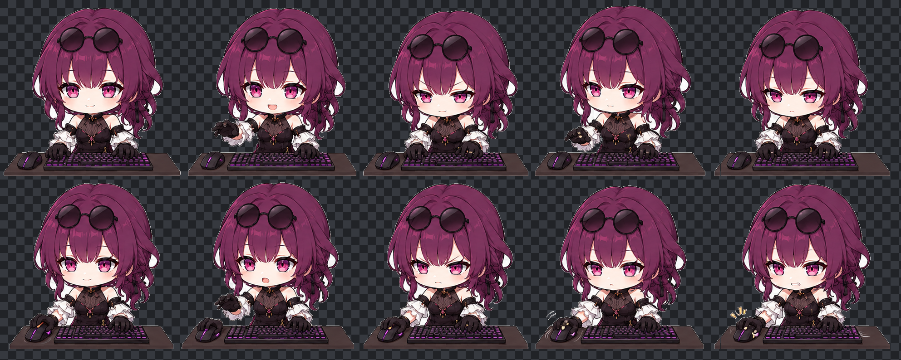

# Zhuoc Desktop Pet

[简体中文](#简体中文) | [English](#english)

A lightweight Windows desktop pet that reacts to keyboard and mouse activity with a transparent, always-on-top sprite animation.

<p>
  <a href="https://github.com/capwitf/zhuoc-desktop-pet/stargazers"></a>
  <a href="https://github.com/capwitf/zhuoc-desktop-pet/network/members"></a>
  <a href="https://github.com/capwitf/zhuoc-desktop-pet/issues"></a>
  <a href="LICENSE"></a>
</p>



## 简体中文

Zhuoc Desktop Pet 是一个 Windows 桌面宠物，会根据键盘和鼠标活动切换 PNG 动作帧。它使用普通 PNG sprite sheet，不是 Live2D。

### 功能

- 透明置顶窗口，可拖动和缩放。
- 普通模式按键盘输入切换动作；游戏模式响应 WASD 和鼠标动作。
- `auto` 模式根据前台窗口标题或进程名识别部分 FPS 游戏，也可追加自定义关键词。
- 使用自带的 2 行 5 列精灵图，并可重新生成透明动作帧。

### 安装与运行

需要 Windows、Python 3.9 或更高版本和 pip。

```powershell
python -m pip install -r requirements.txt
python process_sprites.py --sprite tu.png
python desktop_pet.py --mode keyboard
```

### 使用示例

自动检测支持的游戏：

```powershell
python desktop_pet.py --mode auto
```

强制进入游戏模式，或为自动检测添加进程/窗口关键词：

```powershell
python desktop_pet.py --mode game
python desktop_pet.py --mode auto --game-keyword "my-game.exe"
```

调整尺寸和初始位置：

```powershell
python desktop_pet.py --mode keyboard --size 420 --x 100 --y 500
```

左键拖动角色，拖动右下角缩放控点调整大小，在角色头部右键关闭。

### 隐私

程序运行时通过 Windows `GetAsyncKeyState` 读取按键状态以触发动画，并读取前台窗口标题或进程名以判断是否进入游戏模式。代码不会保存或传输这些信息，也不发起网络请求。

### 打包

```powershell
.\build_exe.ps1
```

打包后的文件位于 `dist/ZhuocDesktopPet.exe`。该可执行文件由本地构建生成，不纳入源码仓库。

## English

Zhuoc Desktop Pet is a Windows desktop companion that switches PNG sprite frames in response to keyboard and mouse activity. It uses a regular PNG sprite sheet, not Live2D.

### Features

- Transparent, always-on-top window that can be dragged and resized.
- Keyboard animations in normal mode; WASD and mouse animations in game mode.
- `auto` mode detects selected FPS games by foreground window title or process name, with support for extra keywords.
- Includes a 2-by-5 sprite sheet and a script to generate transparent animation frames.

### Install and Run

Requires Windows, Python 3.9 or later, and pip.

```powershell
python -m pip install -r requirements.txt
python process_sprites.py --sprite tu.png
python desktop_pet.py --mode keyboard
```

### Examples

Automatically detect supported games:

```powershell
python desktop_pet.py --mode auto
```

Force game mode, or add a process/window keyword for automatic detection:

```powershell
python desktop_pet.py --mode game
python desktop_pet.py --mode auto --game-keyword "my-game.exe"
```

Set the size and initial position:

```powershell
python desktop_pet.py --mode keyboard --size 420 --x 100 --y 500
```

Drag the pet with the left mouse button, drag its lower-right resize handle to change its size, and right-click its head to close it.

### Privacy

While running, the app reads key states through Windows `GetAsyncKeyState` to trigger animations. It also reads the foreground window title or process name to detect game mode. The code does not store or transmit this information and makes no network requests.

### Build

```powershell
.\build_exe.ps1
```

The executable is written to `dist/ZhuocDesktopPet.exe`. This locally generated binary is not included in the source repository.

## License

This project is licensed under the [MIT License](LICENSE).
